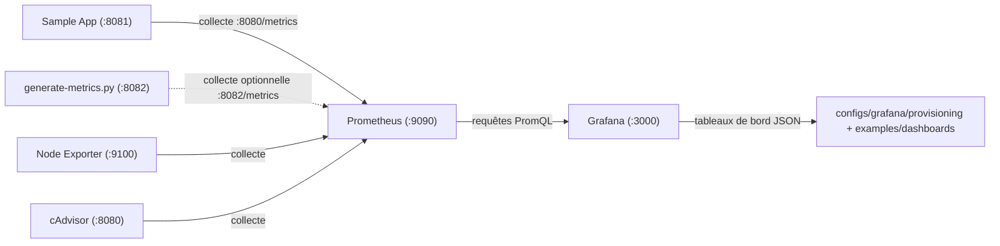

# Formation Grafana et Prometheus

> **Langue :** Français | [English](README.md)

Ce dépôt rassemble un laboratoire complet d'observabilité autour de **Grafana**, **Prometheus**, **Node Exporter**, **cAdvisor**, **Loki**, des playbooks **Ansible**, des aide-mémoires **PromQL** et d'un générateur interactif de configuration `grafana.ini`.

## Architecture du laboratoire



## Démarrage rapide

1. Clonez le dépôt :

```bash
git clone https://github.com/jmrenouard/grafana-training.git
cd grafana-training
```

2. Validez le manifeste Compose puis démarrez la stack :

```bash
docker compose -f docker-compose.yml config -q
./scripts/setup.sh start
```

3. Ouvrez les interfaces locales :

- **Grafana :** `http://localhost:3000` (`admin` / `admin`)
- **Prometheus :** `http://localhost:9090`
- **Node Exporter :** `http://localhost:9100/metrics`
- **cAdvisor :** `http://localhost:8080`
- **Sample App :** `http://localhost:8081`

## Structure du dépôt

| Chemin | Rôle |
| :--- | :--- |
| `docs/fr/` | Documentation Diátaxis en français ([Portail FR](docs/fr/index.md)) |
| `docs/` | Documentation Diátaxis en anglais ([Portail EN](docs/index.md)) et guides de base |
| `configs/` | Configuration Prometheus (`prometheus.yml`, `basic-alerts.yml`) et provisioning Grafana |
| `examples/` | Tableau de bord exemple (`system-overview.json`) et règles d'alerte (`sample-alerts.yml`) |
| `scripts/` | Gestion du cycle de vie (`setup.sh`), `generate-metrics.py` (`:8082`) et installation Ubuntu (`scripts/grafana/`) |
| `ansible/` | Playbooks, rôles, modèles et documentation FR/EN (`ansible/doc/`) |
| `docker/` | Dockerfiles/Makefiles par service et pile Loki/Grafana/Prometheus |
| `configuration/` | Générateur web `grafana.ini` avec schémas JSON FR/EN |

## Espace Documentation (FR)

- **Portail Diátaxis (FR) :** [docs/fr/index.md](docs/fr/index.md) — [Tutoriels](docs/fr/01-tutoriels/index.md), [Guides pratiques](docs/fr/02-guides-pratiques/index.md), [Référence](docs/fr/03-reference/index.md), [Explications](docs/fr/04-explications/index.md)
- **Aide-mémoire PromQL :** [promql_fr.md](promql_fr.md)
- **Playbooks Ansible (FR) :** [doc_monitoring_fr.md](ansible/doc/doc_monitoring_fr.md) | [doc_grafana_fr.md](ansible/doc/doc_grafana_fr.md) | [doc_prometheus_fr.md](ansible/doc/doc_prometheus_fr.md) | [doc_loki_fr.md](ansible/doc/doc_loki_fr.md)
- **Installation Ubuntu 24.04 (Grafana + Nginx) :** [scripts/grafana/README.md](scripts/grafana/README.md) | [Guide complet](scripts/grafana/install_grafana_ubuntu24.md)
- **Documentation anglaise :** [README.md](README.md)

## Tests automatisés

Exécutez la suite de validation hors ligne (YAML, Compose, tableaux JSON, syntaxe Bash, scripts Python, séparation FR/EN et schémas Mermaid) :

```bash
python3 -m unittest discover -s tests -p "test_*.py" -v
```

## Licence

Sous licence GNU General Public License v3.0 — voir [LICENSE](LICENSE).
