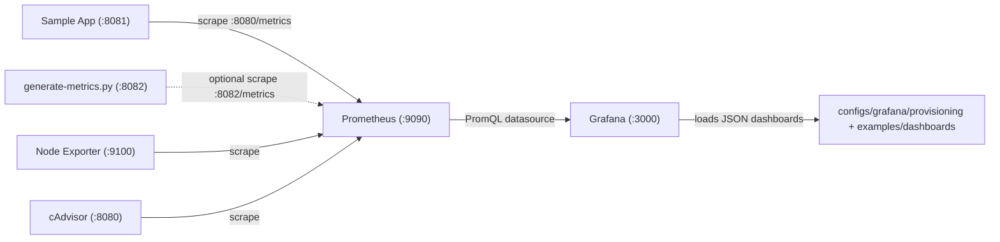

# Grafana and Prometheus Training

> **Language:** English | [Français](README.fr.md)

This repository provides a containerized observability training lab built around **Grafana**, **Prometheus**, **Node Exporter**, **cAdvisor**, **Loki**, **Ansible playbooks**, **PromQL cheat sheets**, and a browser-based `grafana.ini` configuration builder.

## Architecture Overview



## Quick Start

1. Clone this repository:

```bash
git clone https://github.com/jmrenouard/grafana-training.git
cd grafana-training
```

2. Validate the Compose manifest and start the monitoring stack:

```bash
docker compose -f docker-compose.yml config -q
./scripts/setup.sh start
```

3. Open the running endpoints:

- **Grafana:** `http://localhost:3000` (`admin` / `admin`)
- **Prometheus:** `http://localhost:9090`
- **Node Exporter:** `http://localhost:9100/metrics`
- **cAdvisor:** `http://localhost:8080`
- **Sample App:** `http://localhost:8081`

## Repository Structure

| Path | Purpose |
| :--- | :--- |
| `docs/` | English Diátaxis documentation ([Portal](docs/index.md)) and foundational guides |
| `docs/fr/` | French Diátaxis documentation ([Portail FR](docs/fr/index.md)) |
| `configs/` | Prometheus scrape/alert configs and Grafana provisioning definitions |
| `examples/` | Sample Grafana dashboard JSON (`system-overview.json`) and alert rules (`sample-alerts.yml`) |
| `scripts/` | Stack lifecycle helper (`setup.sh`), `generate-metrics.py` (`:8082`), backup/exporter helpers |
| `ansible/` | Bare-metal Ansible playbooks, roles, templates, and EN/FR documentation (`ansible/doc/`) |
| `docker/` | Individual Dockerfiles/Makefiles per exporter plus Grafana/Loki/Promtail compose lab |
| `configuration/` | Standalone HTML `grafana.ini` generator with EN/FR JSON schemas |

## Documentation (Diátaxis & References)

- **Diátaxis Portal (EN):** [docs/index.md](docs/index.md) — [Tutorials](docs/01-tutorials/index.md), [How-To Guides](docs/02-how-to-guides/index.md), [Reference](docs/03-reference/index.md), [Explanation](docs/04-explanation/index.md)
- **Foundational Guides (EN):** [Installation](docs/installation.md) | [Grafana Tutorial](docs/grafana-tutorial.md) | [Prometheus Guide](docs/prometheus-guide.md) | [Troubleshooting](docs/troubleshooting.md)
- **PromQL & Provisioning:** [PromQL Cheat Sheet (EN)](promql.md) | [Grafana Config Generator](configuration/README.md) | [Docker Services](docker/README.md) | [Ansible Stack Docs](ansible/doc/doc_monitoring.md)
- **French Documentation:** [README.fr.md](README.fr.md) | [Portail Diátaxis FR](docs/fr/index.md) | [Aide-mémoire PromQL FR](promql_fr.md)

## Automated Checks

Run the repository verification suite (YAML, Compose, JSON dashboards/configs, shell syntax, Python metrics generator, Diátaxis & Mermaid checks):

```bash
python3 -m unittest discover -s tests -p "test_*.py" -v
```

## License

Licensed under the GNU General Public License v3.0 — see [LICENSE](LICENSE).
