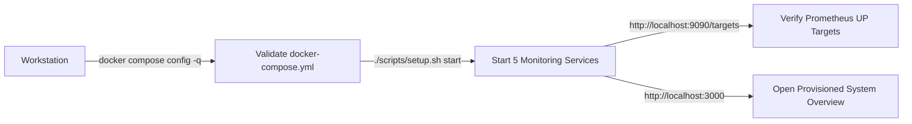

# Tutorial 1: Monitoring Lab Setup with Docker Compose

In this tutorial, you validate the root Compose configuration, launch the 5-service monitoring lab (`prometheus`, `grafana`, `node-exporter`, `cadvisor`, `sample-app`), and confirm that Prometheus scrapes metrics and Grafana displays the provisioned dashboard.

- **Estimated Time:** 10 minutes
- **Files Used:** `docker-compose.yml`, `scripts/setup.sh`, `configs/prometheus/prometheus.yml`, `configs/grafana/provisioning/`

## Prerequisites

- Docker Engine and Docker Compose V2 (`docker compose version`)
- Curl and Python 3 on your host

## Lab Deployment Flow



## Step 1: Validate Compose and Prometheus Configuration

Check `docker-compose.yml` syntax and confirm the Prometheus scrape configuration loads cleanly:

```bash
docker compose -f docker-compose.yml config -q
python3 -c "import yaml, pathlib; yaml.safe_load(pathlib.Path('configs/prometheus/prometheus.yml').read_text())"
```

## Step 2: Start the Monitoring Stack

Use `scripts/setup.sh` to check Docker availability, start all containers in detached mode, and probe Grafana and Prometheus:

```bash
chmod +x scripts/setup.sh
./scripts/setup.sh start
./scripts/setup.sh status
```

Expected services listening locally:

- Grafana on `http://localhost:3000` (`admin` / `admin`)
- Prometheus on `http://localhost:9090`
- Node Exporter on `http://localhost:9100`
- cAdvisor on `http://localhost:8080`
- Sample App on `http://localhost:8081`

## Step 3: Verify Prometheus Targets and Provisioned Grafana Dashboard

1. Open `http://localhost:9090/targets` and confirm `prometheus`, `node-exporter`, `cadvisor`, `sample-app`, and `grafana` appear as scrape jobs configured in `configs/prometheus/prometheus.yml`.
2. Open `http://localhost:3000`, sign in with `admin` / `admin`, and confirm the **System Overview** dashboard from `examples/dashboards/system-overview.json` is automatically loaded by `configs/grafana/provisioning/dashboards/dashboards.yml`.

## Step 4: Stop the Lab Cleanly

```bash
./scripts/setup.sh stop
```

## Next Steps

- Continue to [Tutorial 2: Dashboards, Alert Rules, and Custom Exporter Metrics](02-dashboards-alerts-and-metrics.md).
- Inspect port bindings and mounted config paths in [Reference: Ports, Configs, and Scripts](../03-reference/ports-configs-and-scripts.md).
