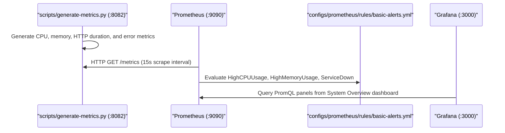

# Tutorial 2: Dashboards, Alert Rules, and Custom Exporter Metrics

In this tutorial, you inspect the synthetic Prometheus exporter (`scripts/generate-metrics.py`), examine how Grafana loads `examples/dashboards/system-overview.json`, and trace alert rule evaluation across `configs/prometheus/rules/basic-alerts.yml`.

- **Estimated Time:** 10 minutes
- **Prerequisites:** Completed [Tutorial 1](01-monitoring-lab-setup.md) or Python 3 available locally

## Synthetic Metrics Pipeline



## Step 1: Run the Custom Metrics Generator (`scripts/generate-metrics.py`)

Verify CLI flags and start the lightweight HTTP exporter on default port `8082` (distinct from the containerized `sample-app` on `8081`):

```bash
python3 scripts/generate-metrics.py --help
python3 scripts/generate-metrics.py --port 8082 --verbose
```

In a second terminal, fetch the exposed metrics endpoint:

```bash
curl -s http://localhost:8082/metrics | head -n 20
```

Expected metric families include `cpu_usage_percent`, `memory_usage_percent`, `network_received_bytes_total`, `http_requests_total`, `http_request_duration_seconds`, and `http_errors_total`.

## Step 2: Inspect Provisioned Dashboard JSON and Alert Rules

Validate that `examples/dashboards/system-overview.json` and both YAML alert rule files parse cleanly:

```bash
python3 -c "import json, yaml, pathlib; json.loads(pathlib.Path('examples/dashboards/system-overview.json').read_text()); yaml.safe_load(pathlib.Path('configs/prometheus/rules/basic-alerts.yml').read_text()); yaml.safe_load(pathlib.Path('examples/alerts/sample-alerts.yml').read_text()); print('DASHBOARD_AND_ALERTS_OK')"
```

Notice `configs/prometheus/rules/basic-alerts.yml` defines `HighCPUUsage` (`> 80`), `HighMemoryUsage` (`> 90`), `DiskSpaceLow` (`> 85`), and `ServiceDown` (`up == 0`), matching the PromQL expressions inside `examples/dashboards/system-overview.json`.

## Next Steps

- Practice custom PromQL queries in [PromQL Cheat Sheet](../../promql.md).
- Follow [How-To: Provision Dashboards and Back Up Grafana](../02-how-to-guides/provision-dashboards-and-backup.md).
