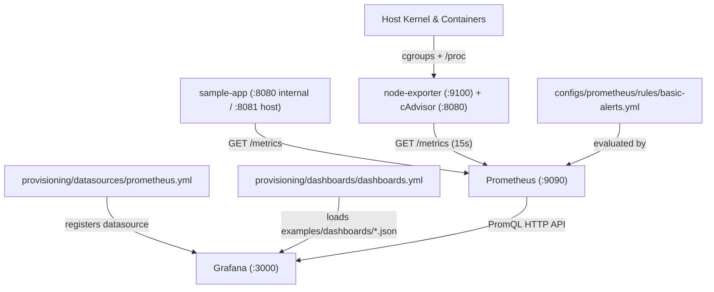

# Scraping, Provisioning, and Deployment Models

This document explains how `grafana-training` separates metric collection, storage, visualization, and infrastructure provisioning across Docker and bare-metal Ansible workflows.

## Pull Scraping vs File Provisioning

- **Pull-Based Collection:** Prometheus polls configured HTTP `/metrics` endpoints (`prometheus`, `node-exporter`, `cadvisor`, `sample-app`, `grafana`) every `15s` as defined in `configs/prometheus/prometheus.yml`. Targets do not push metrics directly into Prometheus in the default Compose lab, whereas `scripts/generate-metrics.py` exposes an HTTP `/metrics` endpoint on port `8082` using the same exposition format.
- **Declarative Provisioning:** Mounting `./configs/grafana/provisioning` and `./examples/dashboards` into the Grafana container ensures the default `Prometheus` data source (`http://prometheus:9090`) and `System Overview` dashboard load automatically on container startup without manual UI setup.

## Docker Lab vs Ansible & Ubuntu Playbooks

The repository offers three distinct deployment tracks tailored to different learning stages:

1. **Docker Compose Lab (`docker-compose.yml`):** Fastest sandbox for PromQL queries, dashboard creation, and alert evaluation on a single workstation using prebuilt upstream images.
2. **Modular Docker Exporters (`docker/`):** Individual `Dockerfile` + `Makefile` examples for 15 monitoring services plus a Loki/Promtail compose variant (`docker/docker-compose.yml`).
3. **Bare-Metal Provisioning (`ansible/` & `scripts/grafana/`):** Production-like systemd deployment via Ansible roles (`grafana`, `prometheus`, `loki`, `node_exporter`, `metricbeat`) or standalone Ubuntu 24.04 Bash installers behind Nginx. Note that `ansible/inventory/hosts` defaults to `[monitoring]` while `ansible/playbooks/monitoring.yml` targets `monitoring_servers`, requiring inventory alignment before live execution.
