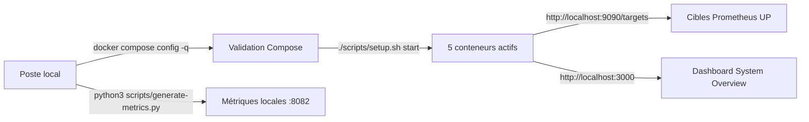

# Atelier 1 : Déployer la stack de monitoring sous Docker Compose

Dans ce tutoriel, vous validez la configuration Compose racine, lancez les 5 services de supervision (`prometheus`, `grafana`, `node-exporter`, `cadvisor`, `sample-app`) et observez les métriques collectées dans Grafana ainsi que le générateur Python local `scripts/generate-metrics.py`.

- **Durée estimée :** 15 minutes
- **Fichiers utilisés :** `docker-compose.yml`, `scripts/setup.sh`, `scripts/generate-metrics.py`, `examples/dashboards/system-overview.json`

## Prérequis

- Docker Engine et Docker Compose V2 (`docker compose version`)
- `curl` et Python 3 installés sur le poste

## Flux de l'atelier



## Étape 1 : Valider les fichiers Compose et YAML

Contrôlez la syntaxe de `docker-compose.yml` et des règles d'alerte :

```bash
docker compose -f docker-compose.yml config -q
python3 -c "import yaml, pathlib; [yaml.safe_load(pathlib.Path(p).read_text()) for p in ('configs/prometheus/prometheus.yml', 'configs/prometheus/rules/basic-alerts.yml')]"
```

## Étape 2 : Démarrer la stack Docker

Lancez l'environnement via `scripts/setup.sh` :

```bash
chmod +x scripts/setup.sh
./scripts/setup.sh start
./scripts/setup.sh status
```

Accédez aux services exposés :

- **Grafana :** `http://localhost:3000` (`admin` / `admin`)
- **Prometheus :** `http://localhost:9090`
- **Node Exporter :** `http://localhost:9100/metrics`
- **cAdvisor :** `http://localhost:8080`
- **Sample App :** `http://localhost:8081`

## Étape 3 : Tester le générateur de métriques Python

Démarrez le serveur synthétique sur son port par défaut (`8082`) :

```bash
python3 scripts/generate-metrics.py --help
python3 scripts/generate-metrics.py --port 8082 --verbose
```

Interrogez ensuite `http://localhost:8082/metrics` depuis un second terminal pour observer les compteurs et jauges exposés au format Prometheus.

## Étape 4 : Arrêter l'environnement

```bash
./scripts/setup.sh stop
```

## Étapes suivantes

- Consultez [Guide pratique : Déployer et vérifier la stack](../02-guides-pratiques/deployer-et-verifier-stack.md).
- Explorez l'[Aide-mémoire PromQL FR](../../../promql_fr.md).
