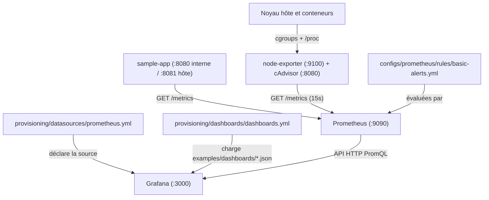

# Architecture de collecte et provisionnement

Ce document décrit comment le laboratoire sépare la collecte des métriques, l'évaluation des alertes et le provisionnement déclaratif Grafana.

## Collecte pull et chargement des tableaux de bord

- **Modèle pull :** Prometheus interroge périodiquement les points d'accès `/metrics` configurés dans `configs/prometheus/prometheus.yml` toutes les 15 secondes. Le script autonome `scripts/generate-metrics.py` expose le même format texte sur le port `8082`.
- **Provisionnement déclaratif :** Le montage de `./configs/grafana/provisioning` et `./examples/dashboards` enregistre automatiquement la source de données `Prometheus` (`http://prometheus:9090`) et le tableau de bord `System Overview` au démarrage du conteneur.

## Comparaison des pistes de déploiement

1. **Docker Compose racine (`docker-compose.yml`) :** Environnement de formation immédiat sur un poste unique.
2. **Services Docker unitaires (`docker/`) :** Exemples de `Dockerfile` et `Makefile` pour 15 services ainsi qu'une pile Loki/Promtail (`docker/docker-compose.yml`).
3. **Provisionnement hôte (`ansible/` et `scripts/grafana/`) :** Déploiement systemd via rôles Ansible ou installation Ubuntu 24.04 derrière Nginx. L'inventaire `ansible/inventory/hosts` définit `[monitoring]` alors que `ansible/playbooks/monitoring.yml` cible `monitoring_servers`, ce qui impose d'aligner le groupe d'hôtes avant exécution en production.
